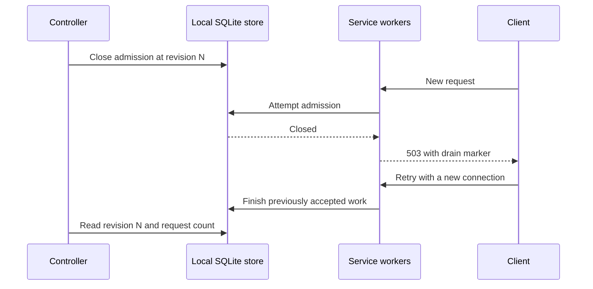

# Request draining

Draining means refusing new requests while accepted requests finish.
The framework provides an optional gate and a count shared by workers in one container.
The client retries explicit drain rejections before benchmark work starts.

This capability is disabled by default.
It does not change routing, retain old deployments, or stop tasks.
A deployment controller must supply those operations.



## Initialize the store

Create one store on a local filesystem before starting service workers.
Use a fresh path for each container lifetime.
Do not use EFS or another network filesystem.
Do not delete or replace the store while workers can own requests.

Run this initialization code once in the container entrypoint:

```python
from benchmark_service.draining import DrainState

state = DrainState.create("/tmp/benchmark-drain.sqlite")
```

Set `BENCHMARK_SERVICE_DRAIN_STATE_PATH=/tmp/benchmark-drain.sqlite` before starting the service.
Every worker opens the same existing store.
An absent or invalid store prevents application construction.

New stores start closed at revision `-1`.
This revision means that control state is unknown, even when the request count is zero.
The controller must apply the intended state before routing traffic to the task.
The `/health` endpoint remains available while admission is closed.
Health alone does not prove that the task accepts work.

## Apply control state

The controller uses the local API from the same container or through its own authenticated adapter.
The framework adds no control endpoint.
The controller must own a monotonic revision, an integer that increases for each command.

```python
from benchmark_service.draining import DrainState

state = DrainState("/tmp/benchmark-drain.sqlite")
store_id = state.store_id
state.set_admission(accepting=True, revision=0, store_id=store_id)
state.set_admission(accepting=False, revision=1, store_id=store_id)
snapshot = state.snapshot()
```

Persist the task identity and `store_id` when registering the task with the controller.
Address later commands to that recorded identity.
Do not substitute a new store identity when retrying an old command.
The API ignores older revisions and rejects conflicting commands at the same revision.
It rejects commands for another store.

Admission and request ownership use one SQLite transaction.
The middleware counts each accepted HTTP request or WebSocket scope until the application returns.
This includes cleanup that the application awaits.
It does not cover detached jobs or later requests from the same run.
Repeated completion cannot reduce another request's count.

A worker crash leaves its owned requests in the store.
This blocks automatic retirement instead of reporting a false zero.
Missing, replaced, locked, or corrupt stores raise errors.
The controller must treat these errors as unknown completion.

## Interpret completion

`snapshot.drained` means that admission is closed, a control revision exists, and no counted request remains.
It is an observation, not permanent permission to delete the task.
The controller must prevent a reopen command from racing with retirement.

Before retiring a generation, the controller must account for every task and its store identity.
Replacement tasks must receive the closed state before they become routable.
If a controller operation fails, retain the task until completion is known.

Zero requests does not mean that every benchmark run finished.
A run can make another request during grading, final scoring, or recovery.
Release retention and routing must account for those later calls separately.

## Client behavior

The gate returns HTTP 503 with `X-Benchmark-Service-Draining: 1` before it dispatches benchmark work.
WebSocket rejection occurs during the opening handshake, before the client sends its payload.
The client retries only this explicit status and marker.

The client starts retries for up to 60 seconds.
HTTP retries use a separate connection pool with keep-alive disabled.
They leave unrelated requests in the shared pool alone.
Once a request starts, its normal timeout applies.
The retry window does not impose a 60-second grading deadline.

WebSocket retries open a new connection.
Once the handshake succeeds, this retry loop never replays the payload.
It does not retry ordinary 503 responses or ambiguous connection failures.
Existing legacy HTTP retries remain unchanged.

The server must support the ASGI `websocket.http.response` extension for marked WebSocket rejection.
Without that extension, the gate rejects the handshake without a retry marker.
The client then reports the error.

New connections allow fresh address resolution, but DNS caches can still return an old task.
The deployment controller must publish the replacement address before closing old admission.
This capability alone does not provide a zero-downtime deployment.
