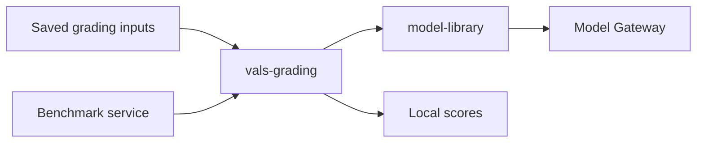

# vals-grading

Grade saved benchmark responses with local prompts and the Model Gateway.
The package returns per-check results and weighted scores without contacting the Vals platform.
It has its own release version and does not depend on create-benchmark-service.



## Install

From the repository root, enter the grading package and install the Gateway integration:

```bash
cd packages/vals-grading
uv sync --extra gateway
```

Set `MODEL_GATEWAY_URL`, `MODEL_GATEWAY_API_KEY`, and `IDENTITY` before starting Python.
`IDENTITY` is a JSON object that identifies the service in Gateway usage records, such as `{"service":"my-benchmark"}`.
The judge sends it with `agent_name` set to `"grader"`, so Gateway usage records separate judge spend from the agent's. When the host binds a `model_library.attribution.attribution_scope` (create-benchmark-service does so for each evaluation request), judge calls are also attributed to that run, task and attempt; outside one they are attributed to no run.
Then run the example against the Gateway:

```bash
uv run --extra gateway python examples/grade_saved_response.py
```

This command sends a model request and incurs provider charges.
The example reads a synthetic grading case and a saved response from local JSON files.
Replace those files with your benchmark inputs.
Keep judge prompts and reference context in service-private storage.

## Service integration

```python
from pathlib import Path

from vals_grading import CheckJudge, GradingCase
from vals_grading.gateway import GatewayJudgeModel

case = GradingCase.model_validate_json(Path("case.json").read_text())
judge = CheckJudge(GatewayJudgeModel("anthropic/claude-opus-4-7"))
result = await judge.grade_test(case, "candidate response", {})
score = result.pass_percentage_with_weight
```

A grading case contains a test ID, input text, JSON context, and checks.
Each check contains its operator name, prompt, criterion, and severity weight.
All fields are required, and unknown fields fail validation.
`examples/case.json` shows the complete format.
Services pin the package version together with their grading inputs and model choice.
The distribution version starts at `0.1.0`; this checkout is not a published release.

To install from Git, use the package subdirectory and pin a reviewed commit:

```bash
uv add "vals-grading[gateway] @ git+https://github.com/vals-ai/create-benchmark-service.git@<commit>#subdirectory=packages/vals-grading"
```

Replace `<commit>` with the full commit SHA that you reviewed.
This installs only the grading distribution and its selected dependencies.
The package version comes from this directory's `pyproject.toml`, independently of CBS tags.

The core package depends only on Pydantic.
The `gateway` extra adds public `model-library`.
`vals_grading.protocols.JudgeModel` defines the two methods needed for another model implementation.
`GatewayJudgeModel` is the reference implementation and requires Gateway configuration.

## Existing Vals suites

Install the `vals` extra to convert an already loaded SDK suite:

```python
from vals_grading.adapters.vals import export_suite, to_test_result

cases = export_suite(suite, operators)
result = await judge.grade_test(cases[test.id], transcript, output_context)
sdk_result = to_test_result(result, test, transcript, output_context, metadata)
```

`operators` maps operator names to exported `CustomOperatorPrompt` values.
Export cases during dataset preparation, then save each case with `model_dump_json()`.
Load those saved cases in the service to remove platform access from grading startup.
The adapter performs no network calls.
Loading suites from the platform and uploading results remain caller-owned operations.

For service deployment and dataset setup, use the existing
[benchmark onboarding guide](https://github.com/vals-ai/benchmark-services-registry/blob/dev/docs/VALKYRIE_ONBOARDING.md).

## Grading behavior

The first version implements binary custom checks from platform revision `d63fdbd` and CBS PR #213 at `27ffd6e6`.
It preserves prompt replacement order, two fallback requests, per-test concurrency of ten, and severity-weighted scoring.
Unlike the platform parser, it rejects nonbinary JSON scores and limits final requery scores to zero or one.
Results carry their saved grading case. SDK conversion rejects changes to the test inputs, context, checks, or weights.
Nested context substitutions retain the platform's outer braces.
Negative severity weights penalize failing checks.
Model exceptions become failed checks with `eval_error=true`.
Cancellation propagates to the caller instead of producing a score.

Confidence evaluation is disabled.
Successful checks use confidence value `0.5`, and errored checks use `0`.
The low-confidence percentage is therefore `1` when any check errors and `0` otherwise.
It is not the fraction of all checks that failed.

The adapter rejects built-in operators, global checks, golden outputs, rubrics, conditional checks, extractors, and examples.
An empty rubric list represents a binary check, as it does on the platform.
The engine rejects file placeholders and full input contexts above 50,000 tokens before grading.
It removes `trajectory_atif` from output context before rendering prompts.
Use `require_gradeable(case)` during startup to detect unsupported prompts early.
`grade_test` repeats this validation against its own copy of the input.

## Development

Run these commands from `packages/vals-grading`:

```bash
make install
make test
make lint
make typecheck
make build
```

Tests use recorded model replies and blocked platform access.
They cover prompt compatibility, score calculation, failure handling, cancellation, SDK conversion, and the Gateway request boundary.
They do not establish live model agreement or deployed service adoption.
